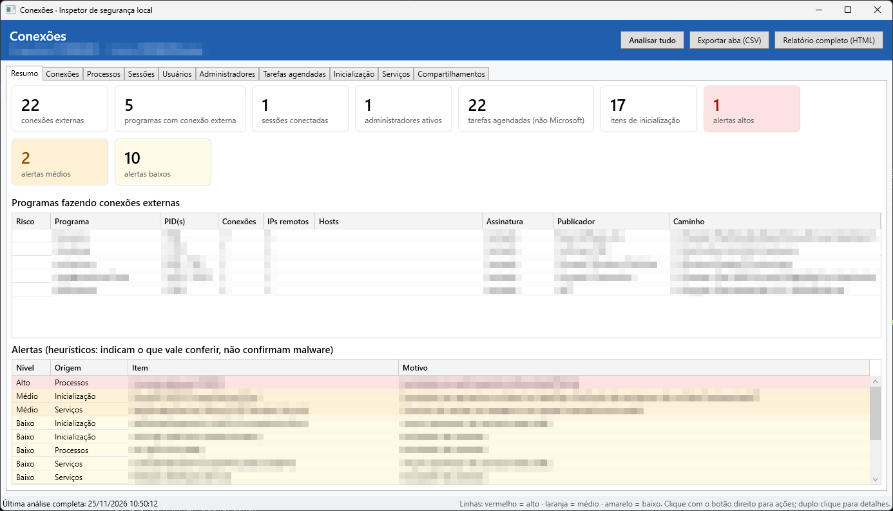

<div align="center">

<h1>Conexões</h1>

<h3>🛡️ Inspetor de segurança local para Windows</h3>

<p>Mostra quem e o que está conectado à sua máquina: conexões de rede, processos, sessões, contas,<br/>
tarefas agendadas, inicialização, serviços e compartilhamentos, com alertas do que vale conferir.</p>

<a href="https://github.com/robsonpedroso/conexoes/releases/latest"></a>
<a href="https://github.com/robsonpedroso/conexoes"></a>
<a href="LICENSE"></a>

<br/><br/>


<br/><br/>



</div>

## O que o app mostra

App desktop (C# .NET 10 + WPF) que mostra, na máquina local:

| Aba | O que mostra | Equivale a |
|---|---|---|
| Resumo | Programas com conexão externa + alertas priorizados | – |
| Conexões | TCP/UDP com processo, IP/host remoto, escopo (externo/privado), assinatura | `netstat -ano` + `tasklist /fi "pid eq N"` |
| Processos | Todos os processos, pai, usuário, linha de comando, assinatura, nº de conexões | `tasklist /v` |
| Sessões | Quem está logado (console/RDP) e acessos SMB | `query user`, `net session` |
| Usuários | Contas locais, ativas, último logon, política de senha | `net user` |
| Administradores | Membros do grupo Administradores (pelo SID, independe do idioma) | `net localgroup Administradores` |
| Tarefas agendadas | Ações, gatilhos, conta, privilégio, assinatura do executável | `schtasks /query /v` |
| Inicialização | Run/RunOnce (HKLM/HKCU/WOW64), pastas Inicializar, Winlogon | `reg query ...\Run` |
| Serviços | Caminho, conta, modo de início, assinatura, caminho sem aspas | `sc query` |
| Compartilhamentos | Pastas compartilhadas | `net share` |

Os dados vêm das APIs do Windows (iphlpapi, wtsapi32, netapi32, WMI, Agendador de Tarefas COM, WinVerifyTrust),
não do texto dos comandos, por isso funcionam em qualquer idioma do Windows.

## Por que desktop e não web
O app precisa de acesso ao sistema operacional e de privilégio de administrador. Um navegador não consegue fazer isso,
e um servidor web local com privilégio de administrador exporia uma porta com dados sensíveis sem necessidade.

## Alertas
Os alertas são heurísticos e indicam o que vale conferir, não confirmam malware. Exemplos: executável em Temp/Downloads
com conexão externa, binário sem assinatura confiável, PowerShell com `-EncodedCommand`/`IEX`/download, `mshta`,
`regsvr32 /i:http`, Winlogon alterado, conta Convidado ativa, RDP vindo de IP externo, entrada apontando para
arquivo inexistente e caminho de serviço sem aspas.

## Download
Baixe o `Conexoes.App.exe` em [Releases](https://github.com/robsonpedroso/conexoes/releases/latest). É um executável único
e portátil: não precisa instalar nem ter o .NET instalado.

- O app pede **privilégio de administrador** (UAC), necessário para ler processos do sistema, sessões e tarefas.
- Ele é **somente leitura**: só altera algo quando você usa "Finalizar processo" no menu de contexto.
- O executável não é assinado digitalmente, então o Windows SmartScreen pode exibir um aviso na primeira execução.

## Compilar, testar e executar
```powershell
dotnet build
dotnet test                                   # unitários + integração (leem o sistema real, somente leitura)
dotnet run --project src\Conexoes.App         # pede elevação (UAC)
```

## Gerar o .exe único (portátil)
```powershell
dotnet publish src\Conexoes.App -c Release -r win-x64 --self-contained `
  -p:PublishSingleFile=true -p:IncludeNativeLibrariesForSelfExtract=true `
  -p:EnableCompressionInSingleFile=true -p:DebugType=none -o publish
```
Resultado: `publish\Conexoes.App.exe` (~62 MB, não precisa do .NET instalado).

## Relatório automático
```powershell
Conexoes.App.exe --relatorio C:\auditoria\relatorio.html
```
Abre, analisa tudo, salva o relatório HTML e fecha. Pode ser usado numa tarefa agendada.

## Estrutura
```
src/Conexoes.Core     coletores, regras de risco, verificação de assinatura, exportação (sem UI)
src/Conexoes.App      WPF (MVVM com CommunityToolkit.Mvvm)
tests/Conexoes.Tests  xUnit
```

## Contribuindo
Sugestões e correções são bem-vindas. Veja [CONTRIBUTING.md](CONTRIBUTING.md) e o
[Código de Conduta](CODE_OF_CONDUCT.md).

## Segurança
Encontrou uma vulnerabilidade? Não abra uma issue pública: siga [SECURITY.md](SECURITY.md).

## Licença
Distribuído sob a licença MIT. Veja [LICENSE](LICENSE).
